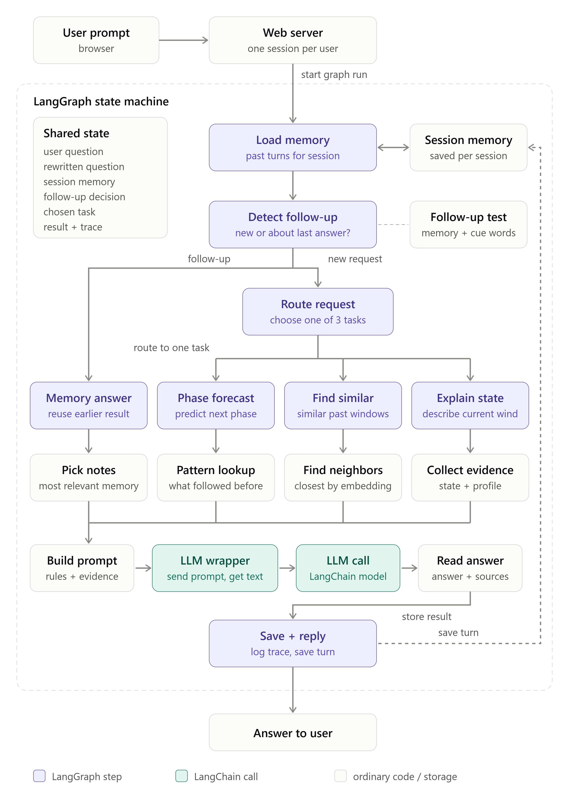

# Interpretable Semantic Wind-Regime Forecasting

Reproducibility code and saved outputs for the thesis/paper **Interpretable Semantic Wind-Regime Forecasting with a Controlled Human-in-the-Loop Layer**. The repository contains the complete offline benchmark, semantic artifacts, second-station evaluation, paper figure data, and the live HITL review interface.

<div align="center">
  <a href="https://wind-phase-review-demo.onrender.com/">
    
  </a>
  <br><br>
  <strong>Explore wind-regime forecasts, historical evidence, and LLM-supported explanations.</strong>
  <br>
  <sub>The hosted service may take a short moment to start after a period of inactivity.</sub>
</div>

## How the HITL Interface Works

<p align="center">
  
</p>

Each question goes through a small LangGraph state machine. The graph is controlled, not free-form: a fixed set of steps passes a shared state from one step to the next. The LLM never decides which step runs.

**1. Session and memory.** The web server gives each user a session, and the session ID is used as the conversation thread. The first step loads that thread's past turns and last results from a small JSON memory file.

**2. Follow-up or new request?** The graph checks whether the question refers back to the last answer, such as "why was this phase selected?". It uses simple rules: stored memory plus cue words in the question.

- **Follow-up:** the graph picks the most relevant notes from memory and asks the LLM to answer using only those notes. No task runs again.
- **New request:** a router picks one of three tasks by matching keywords in the question: predict the next wind phase, find similar past windows, or explain the current wind state.

**3. Task, evidence, then explanation.** Each task runs ordinary Python code first:

- **Forecaster:** predicts the next wind phase with a variable-order Markov-style transition model. It counts which phase followed the same recent regime sequence in past data, and falls back to shorter sequences when there is too little history.
- **Retriever:** finds the nearest historical windows using cosine similarity on embeddings.
- **Explainer:** collects the current state and its regime profile.

The result is an evidence pack. It is put into a prompt and sent to the LLM through LangChain (`ChatOpenAI`). The LLM only turns the evidence into plain language. It does not choose the task or change the prediction.

**4. Save and reply.** The final step stores the result and a short trace in session memory, so the next question can build on it, and returns the answer. The user can also accept, flag, or add a note to a result; these are saved in a feedback log.

**LangGraph and LangChain.** LangGraph manages the flow: steps, shared state and routing. LangChain is only used as the LLM client inside those steps.

## Method at a Glance

1. Convert NOAA/ASOS observations to a consistent five-minute schema.
2. Build overlapping four-hour windows (`48` observations, one-hour stride).
3. Summarize each window with `36` physical/statistical descriptors.
4. Standardize and compress the descriptors to an `8`-dimensional PCA embedding.
5. Discretize embeddings with mini-batch k-means into `8` wind-regime tokens and retain distance to the assigned centroid as an atypicality score.
6. Evaluate continuous forecasting from raw, PCA, autoencoder, and regime-token representations.
7. Evaluate next-regime classification with persistence, a variable-order transition-count model, and a GRU.
8. Deploy the transition-count predictor in a LangGraph-controlled HITL workflow with exact nearest-neighbor analog retrieval, OpenAI-backed grounded explanations/follow-ups, session memory, and accept/flag/note feedback.

The language model is used after clustering to assign concise human-readable regime names from cluster profiles and in the HITL explanation layer. It does not assign token IDs, alter embeddings, train forecasting models, or change quantitative predictions.

## Data and Evaluation

- **Primary station:** KBOS (Boston Logan International Airport).
- **Robustness station:** DDC (Dodge City Regional Airport).
- **Data:** NOAA/ASOS five-minute observations from 2024.
- **Chronological split:** 70% train, 15% validation, 15% test for next-regime models.
- **Forecast horizons:** 1, 3, 6, and 12 one-hour window advances.
- **Neural seeds:** 42 and 123; saved summaries average both seeds.
- **Phase metrics:** top-1 accuracy, top-3 accuracy, and macro-F1.
- **Continuous metrics:** MAE, RMSE, sMAPE, and skill relative to persistence.

The DDC benchmark transfers the KBOS-selected neural and gradient-boosting configurations unchanged under the same horizons and seeds. This avoids second-station retuning and makes DDC a deliberately conservative cross-station evaluation; the saved manifests and configuration tables record the transfer protocol.

## Repository Layout

- `app/` - preprocessing, semantic encoding/tokenization, exact nearest-neighbor retrieval, phase forecasting, LangGraph routing, LLM grounding, memory, and feedback modules.
- `scripts/` - semantic build, live METAR adapter, HITL CLI/UI, plotting, carbon calculation, metadata normalization, and anonymous artifact export.
- `theory_experiments/` - two-seed continuous/phase experiments, GRU and transition studies, gradient boosting, and token-state LSTM evaluation.
- `backtest_wind.py` - shared rolling-origin continuous-forecast engine imported by the LSTM and gradient-boosting experiment runners.
- `data/noaa_5min/` - normalized KBOS and DDC five-minute datasets.
- `data/semantic/` - saved window features, embeddings, token assignments, profiles, and representative examples.
- `artifacts/` - fitted PCA encoders, tokenizers, retrieval indexes, and HITL model artifacts.
- `results/` - final result tables and experiment manifests.
- `figures/` - generated paper figures.
- `docs/` - workflow diagram used in this README.
- `tests/` - repository-integrity and portability checks.
- `DATA_CARD.md` - station ranges, provenance notes, live-data distinction, and use limitations.

## Environment

The committed environment was tested with Python 3.10.4 on CPU.

```powershell
python -m venv .venv
.\.venv\Scripts\Activate.ps1
python -m pip install --upgrade pip
python -m pip install -r requirements.txt
```

Run the integrity checks before experiments:

```powershell
python -m unittest discover -s tests -v
python -m compileall -q app scripts theory_experiments backtest_wind.py
```

## Reproduce the Offline Results

The committed CSV/JSON files already contain the reported outputs. Full neural runs can take substantial CPU time.

```powershell
# Primary KBOS two-seed benchmark and compression metrics
python theory_experiments\run_5min_two_seed_final_experiments.py
python theory_experiments\compute_compression_metrics.py

# DDC robustness benchmark
python theory_experiments\run_ddc_5min_two_seed_experiments.py
python theory_experiments\compute_ddc_compression_metrics.py

# Gradient-boosting representation probes
python theory_experiments\run_kbos_gradient_boosting_experiments.py
python theory_experiments\run_ddc_gradient_boosting_experiments.py

# Regime-token-state LSTM extension
python theory_experiments\run_token_state_lstm_experiments.py

# Rebuild paper artifacts from saved results
python scripts\plot_phase_accuracy.py
python scripts\calculate_carbon_footprint.py
```

## Canonical Result Files

- **KBOS:** `results/5min_two_seed_experiments/` (`numeric_5min_two_seed_summary.csv`, `phase_transition_5min_two_seed_summary.csv`, `gru_phase_5min_two_seed_summary.csv`, `compression_metrics_5min.csv`) and `results/kbos_gradient_boosting_experiments/gb_summary.csv`.
- **DDC:** the same four file names under `results/ddc_5min_two_seed_experiments/`, plus `results/ddc_gradient_boosting_experiments/gb_summary.csv`.
- **Token-state LSTM:** `results/token_state_lstm_experiments/` (`token_state_lstm_summary.csv`, `token_state_lstm_metadata.json`).
- **Paper artifacts:** `figures/acc_horizon.png`, `figures/acc_horizon.pdf`, `results/carbon_footprint.csv`.

## Run the HITL Interface

For LLM explanations and memory-grounded follow-up, set an API key and model:

```powershell
$env:OPENAI_API_KEY="your-key"
$env:SEMANTIC_LLM_MODEL="gpt-4o-mini"
python scripts\run_hitl_ui.py --host 127.0.0.1 --port 7861
```

Open `http://127.0.0.1:7861`. On startup the UI attempts to fetch current KBOS observations from the AviationWeather METAR API and rebuild the live semantic state with the committed KBOS encoder/tokenizer. If the network is unavailable, it uses the committed live snapshot. An alternative remote snapshot can be configured with `WIND_LIVE_DATA_BASE_URL`; no personal repository URL is hard-coded.

The fixed UI configuration uses the transition-count phase predictor, top-3 candidates, five analog windows, LangGraph routing, retrieval/memory grounding, and feedback logging. The continuous numeric forecaster is intentionally disabled in the final HITL workflow.

## Build a New Station

```powershell
python scripts\prepare_asos_5min_station.py `
  --input_csv "path\to\station_5min.csv" `
  --output_parquet "data\noaa_5min\STATION_2024_5min.parquet"

python scripts\run_semantic_build.py `
  --data "data\noaa_5min\STATION_2024_5min.parquet" `
  --window_size 48 `
  --step_size 12 `
  --components 8 `
  --clusters 8 `
  --run_name station_5min_phase `
  --enable_llm_labels
```

## Anonymous Submission Artifact

The public development repository and its Git commit history are **not anonymous**. After committing final changes, create a history-free submission ZIP, optionally adding known author identifiers to the scan:

```powershell
python scripts\create_anonymous_artifact.py `
  --blocked-marker "author-name" `
  --blocked-marker "author-email-or-username"
```

The script rejects repository URLs, local paths, and any supplied identity markers, then uses `git archive`, so the ZIP contains neither `.git/` nor commit history. Upload that ZIP or a separately anonymized mirror for double-blind review; do not submit a personal GitHub repository URL.

## Notes

- Retrieval is implemented with scikit-learn's exact cosine `NearestNeighbors` index; FAISS is not required.
- All committed metadata uses project-relative paths and resolves against the current checkout.
- API keys, virtual environments, caches, session memory, and feedback logs are excluded from version control.
- NOAA/ASOS and AviationWeather data remain subject to their source terms and provenance.
